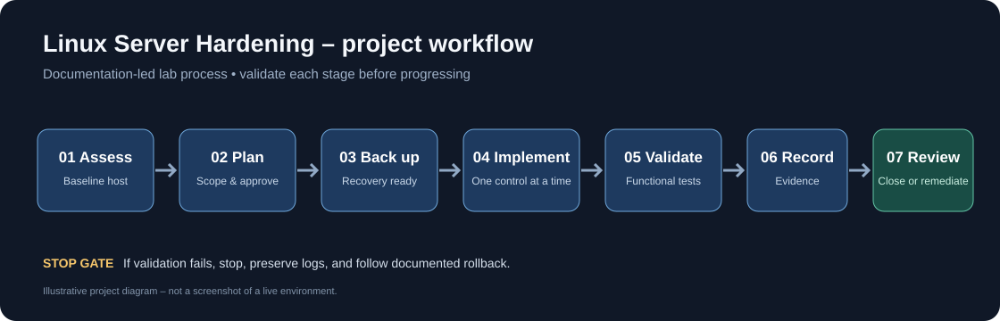

# Linux Server Hardening & Security Automation

A practical, evidence-led Linux security hardening lab focused on Red Hat Enterprise Linux (RHEL), Bash-based administration, and repeatable operational controls.

> **Repository status:** This is currently a documentation and lab-runbook project. The procedures are tutorials and manual verification steps. Executable hardening scripts and production-ready configurations are future work, not existing capabilities.

## Objectives
- Establish a repeatable baseline security assessment.
- Harden SSH remote administration without creating an avoidable lockout.
- Reduce unnecessary inbound network exposure with Firewalld.
- Assess and apply security updates through controlled change management.
- Review users, privileged groups, and sudo permissions.
- Monitor selected security-sensitive changes with auditd.
- Produce verifiable evidence, an assessment report, and remediation actions.

## Start here
- [Documentation index](docs/README.md)
- [Project charter and objectives](docs/project-charter.md)
- [End-to-end implementation guide](docs/implementation-guide.md)
- [Seven detailed tutorials](docs/tutorials/README.md)
- [Project templates](docs/templates/README.md)

## Platform
RHEL 9 is the primary target; many concepts also apply to RHEL 8. Treat RHEL 7/CentOS 7 as a separate compatibility exercise. Verify commands against the exact release and local policy.

## Safety
Take a snapshot/backup, preserve console recovery, keep a working SSH session, test key access before disabling passwords, inspect active firewall zones before changes, coordinate patching/reboots with owners, and do not disable SELinux or auditd to make a test pass.

## Illustrative images
The SVG assets in docs/screenshots are visual mockups, not captures from a live server and not test evidence. Replace them with genuine, redacted lab captures when executing the tutorials.

## References
- [RHEL 9 security hardening](https://docs.redhat.com/en/documentation/red_hat_enterprise_linux/9/html/security_hardening/)
- [RHEL 9 securing networks](https://docs.redhat.com/en/documentation/red_hat_enterprise_linux/9/html/securing_networks/)
- [RHEL 9 DNF guide](https://docs.redhat.com/en/documentation/red_hat_enterprise_linux/9/html/managing_software_with_the_dnf_tool/)
- [NIST SP 800-123](https://csrc.nist.gov/pubs/sp/800/123/final)
- [CIS Benchmarks](https://www.cisecurity.org/cis-benchmarks)

Educational lab material only. It does not establish CIS, DISA STIG, ISO 27001, or other compliance.
