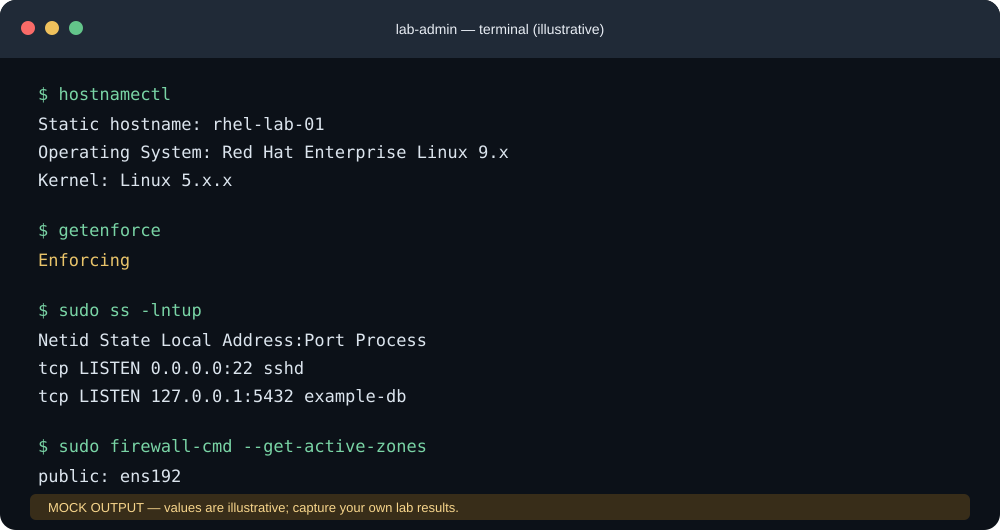
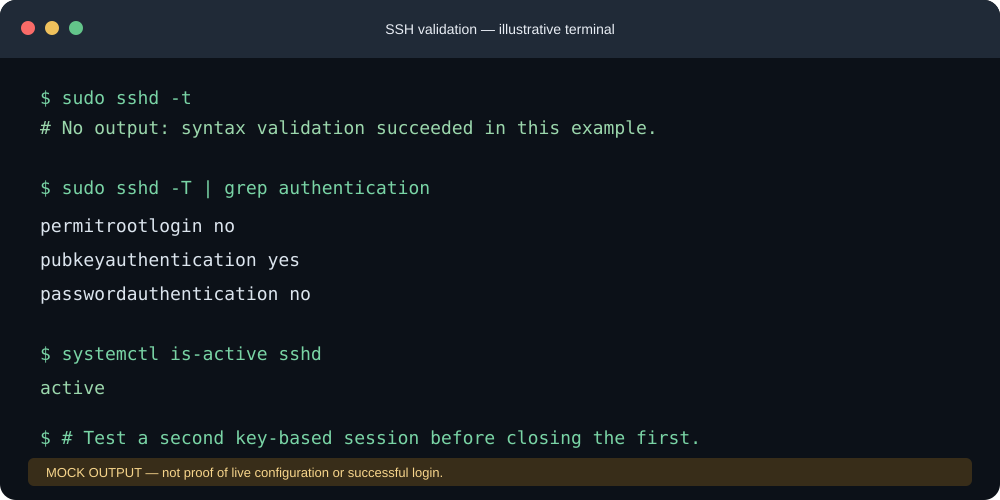
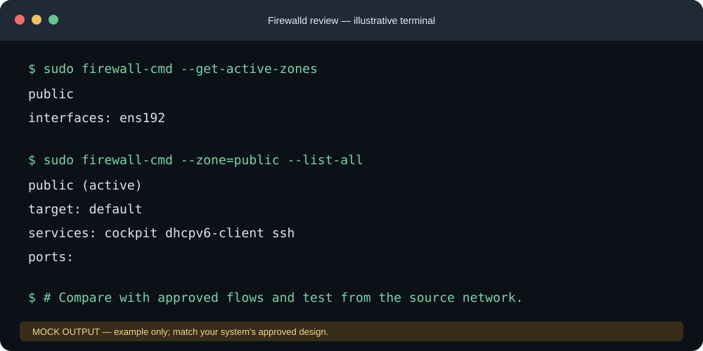
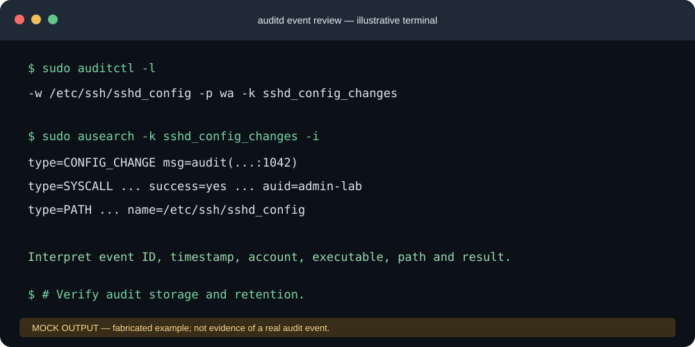

# Linux Server Hardening – practical tutorials

These tutorials are designed for an isolated RHEL 9 lab and should be checked against RHEL 8 or other versions before use. Run commands with an authorised administrator account. Save output in a private evidence directory and redact sensitive information before publication.

## Tutorial 01 – Lab preparation and baseline

**Goal:** establish a recoverable VM and record its current state.

1. Confirm platform and administrator context:

~~~bash
hostnamectl
cat /etc/redhat-release
uname -r
date --iso-8601=seconds
whoami
id
sudo -v
~~~

2. Create a private evidence folder:

~~~bash
mkdir -p "$HOME/linux-hardening-evidence"
chmod 700 "$HOME/linux-hardening-evidence"
umask 077
~~~

3. Capture host, network, service, firewall, SELinux, SSH, package, account, and audit state:

~~~bash
ip -brief address
ip route
sudo ss -lntup
sudo firewall-cmd --get-active-zones
sudo firewall-cmd --list-all-zones
getenforce
sudo sshd -t
sudo sshd -T
sudo dnf repolist
sudo dnf updateinfo summary
getent passwd
getent group wheel
sudo visudo -c
sudo auditctl -s
~~~

4. Take a VM snapshot and record its identifier. A failed command or missing tool is a finding to investigate, not an automatic pass.

## Tutorial 02 – SSH hardening

**Goal:** reduce remote administration exposure without locking yourself out.

**Critical:** do not disable password authentication until a new key-based login is proven. Keep the current SSH connection open and retain console access.

1. Inspect current SSH service and effective policy:

~~~bash
sudo systemctl status sshd --no-pager
sudo sshd -t
sudo sshd -T | grep -E '^(port|permitrootlogin|passwordauthentication|pubkeyauthentication|kbdinteractiveauthentication) '
sudo ss -lntp | grep sshd
~~~

2. On an approved client, create a key if required. Ed25519 is common, but follow cryptographic/FIPS policy:

~~~bash
ssh-keygen -t ed25519 -C "admin-lab-key"
ssh-copy-id -i ~/.ssh/id_ed25519.pub adminuser@server.example
~~~

3. Open a second terminal and prove key login:

~~~bash
ssh -o PreferredAuthentications=publickey adminuser@server.example
~~~

Confirm sudo access before proceeding.

4. Back up the main config and inspect all relevant drop-ins:

~~~bash
sudo install -m 0600 -o root -g root /etc/ssh/sshd_config \
  "/root/sshd_config.pre-hardening.$(date +%Y%m%d-%H%M%S)"
sudo grep -RniE '^(Include|PermitRootLogin|PasswordAuthentication|PubkeyAuthentication|KbdInteractiveAuthentication|AllowUsers|AllowGroups)' \
  /etc/ssh/sshd_config /etc/ssh/sshd_config.d 2>/dev/null
~~~

5. A common named-administrator lab target is:

~~~text
PermitRootLogin no
PubkeyAuthentication yes
PasswordAuthentication no
KbdInteractiveAuthentication no
~~~

These settings are examples, not a universal policy. Confirm central authentication, break-glass access, automation accounts, and local policy first. Do not add AllowUsers/AllowGroups unless the complete access list is known.

6. Validate syntax and effective settings:

~~~bash
sudo sshd -t
sudo sshd -T | grep -E '^(permitrootlogin|passwordauthentication|pubkeyauthentication|kbdinteractiveauthentication) '
sudo sshd -T -C user=adminuser,host=server.example,addr=192.0.2.25
~~~

Replace example connection values. If validation fails, do not reload.

7. Reload only after validation and test a second session again:

~~~bash
sudo systemctl reload sshd
sudo systemctl is-active sshd
~~~

**Rollback:** use console or the original session, restore the backup, run sshd -t, reload, and test. Do not close the working session until recovery is proven.

## Tutorial 03 – Firewalld hardening

**Goal:** restrict inbound exposure to an approved service/port/source list.

**Warning:** incorrect firewall changes can disconnect remote administration. Confirm console recovery and network dependencies first.

1. Inspect state and active interface zones:

~~~bash
sudo firewall-cmd --state
sudo firewall-cmd --get-default-zone
sudo firewall-cmd --get-active-zones
sudo firewall-cmd --list-all-zones
sudo ss -lntup
~~~

2. Build an approved flow table before changing rules. Record interface/zone, source network, service or port, business purpose, and owner. Do not assume the default zone protects the management interface.

3. Inspect runtime and permanent settings for the active zone:

~~~bash
sudo firewall-cmd --zone=public --list-all
sudo firewall-cmd --permanent --zone=public --list-all
sudo firewall-cmd --check-config
~~~

Replace public with the actual active zone. Runtime and permanent settings may differ.

4. Example only: add the standard SSH service permanently if that exact access is approved:

~~~bash
sudo firewall-cmd --permanent --zone=public --add-service=ssh
sudo firewall-cmd --check-config
sudo firewall-cmd --reload
sudo firewall-cmd --zone=public --list-all
~~~

For custom SSH ports, verify the port rule and SELinux port type. Preserve source restrictions and centrally managed policy.

5. Test from a separate client on the intended network:

~~~bash
nc -vz server.example 22
ssh adminuser@server.example
~~~

Test application paths from their intended source networks. Remove only individually identified rules after confirming replacement access. Recheck IPv4 and IPv6.

## Tutorial 04 – Security patch assessment

**Goal:** review security advisories, assess the transaction, apply approved updates, and record restart impact.

1. Check OS and repository health:

~~~bash
cat /etc/redhat-release
sudo dnf repolist
sudo dnf makecache
~~~

2. Review available updates:

~~~bash
sudo dnf check-update
sudo dnf updateinfo summary
sudo dnf updateinfo list --security
~~~

DNF check-update may return status 100 when updates are available. Distinguish that from repository errors. An empty advisory list is meaningful only if metadata refreshed successfully.

3. Preview the transaction where supported:

~~~bash
sudo dnf upgrade --security --assumeno
~~~

Review dependencies, kernel packages, third-party agents, application compatibility, and maintenance needs. Use the preview method supported by the installed DNF version.

4. During the approved window, apply updates:

~~~bash
sudo dnf upgrade --security
~~~

Review the transaction before accepting. Do not use unattended production patching based only on this tutorial.

5. Assess restart requirements:

~~~bash
sudo dnf needs-restarting
sudo dnf needs-restarting -r
uname -r
rpm -q kernel
sudo systemctl --failed
~~~

Coordinate service restarts and reboots with owners. Run application health checks. Preserve transaction details, advisory IDs, failed updates, and decisions.

## Tutorial 05 – User and sudo audit

**Goal:** identify accounts and privileged access requiring owner review. Do not automatically disable accounts because they appear old.

1. Inventory accounts and UID 0:

~~~bash
getent passwd
getent group wheel
awk -F: '$3 == 0 {print $1 ":" $3 ":" $6 ":" $7}' /etc/passwd
~~~

Investigate every UID 0 account other than the approved root account.

2. Review sudo access:

~~~bash
getent group wheel
sudo grep -RniE '^[[:space:]]*[^#].*(ALL|NOPASSWD|sudo|wheel)' /etc/sudoers /etc/sudoers.d 2>/dev/null
sudo visudo -c
sudo -l -U username
~~~

A grep match is only a lead, not a full sudo policy parser. Replace username with the account under review.

3. Review password/account state and activity:

~~~bash
sudo passwd -S username
sudo chage -l username
lastlog
last
~~~

4. Ask the account owner to confirm business need, scheduled jobs, monitoring, backup agents, application use, and identity source before changes. Back up sudoers edits and validate with visudo -c.

## Tutorial 06 – auditd monitoring

**Goal:** load a targeted rule, generate a test event, and retrieve it.

1. Inspect audit service, rules, and health:

~~~bash
sudo systemctl status auditd --no-pager
sudo auditctl -s
sudo auditctl -l
sudo ls -l /etc/audit/rules.d/
~~~

Review existing rules first. Never use auditctl -D as a shortcut on a shared system.

2. In a lab only, add a focused watch rule, for example:

~~~text
-w /etc/ssh/sshd_config -p wa -k sshd_config_changes
~~~

Use a separate file under /etc/audit/rules.d after backing up and reviewing existing configuration. Prefer a lab-owned test file if changing the SSH configuration is unnecessary.

3. On systems managed by augenrules:

~~~bash
sudo augenrules --check
sudo augenrules --load
sudo auditctl -l
sudo auditctl -s
~~~

4. Generate a controlled test event and search:

~~~bash
sudo ausearch -k sshd_config_changes -i
sudo df -h /var/log/audit
~~~

Inspect event time/ID, account, executable, path, and success status. Investigate lost events and log capacity. Remove only the rule created by this exercise during rollback; do not flush all rules.

## Tutorial 07 – Validation and reporting

**Goal:** turn actual test results into a traceable assessment.

1. Repeat relevant checks from tutorials 01–06.
2. Functionally test SSH from a second client, approved and unapproved firewall paths from relevant networks, application health, account review, and audit event retrieval.
3. Record actual outcomes and link each to an evidence ID. Use Pass, Fail, Not tested, Not applicable, or Exception.
4. Create findings with observation, impact, severity rationale, recommendation, owner, due date, and evidence.
5. Complete the [assessment report](../templates/README.md) and [evidence register](../templates/README.md).

Example private evidence folder:
~~~text
linux-hardening-evidence/
├── 01-host-baseline.txt
├── 02-ssh-before.txt
├── 03-ssh-after.txt
├── 04-firewall-before.txt
├── 05-firewall-after.txt
├── 06-dnf-security-review.txt
├── 07-account-review-redacted.txt
└── 08-audit-test-event.txt
~~~

Store raw evidence privately. Only commit sanitised material suitable for public release.
